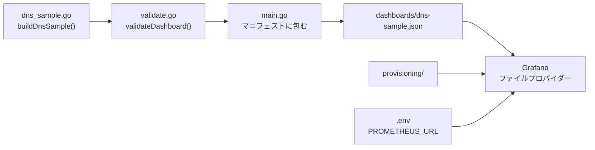

# 処理の解説

このリポジトリが Go のコードから Grafana のダッシュボードを作り、表示するまでを順に追う。
動かし方と規約は [README](../README.md) を参照。

## 1. 全体の流れ



1. `buildDnsSample()` が grafana-foundation-sdk のビルダーでダッシュボードを組み立てる。
2. `validateDashboard()` が、SDK では検出できない誤りを確かめる。
3. `main.go` が Kubernetes 形式のリソースに包み、JSON として書き出す。
4. ローカルの Grafana が `dashboards/` を読み込んで表示する。

`make generate` が 1〜3 を、`make dev` がそれに加えて Grafana の起動までを行う。

## 2. dashboardv2 の JSON の形

出力される `dashboards/dns-sample.json` の骨組みは次のとおり(主要なキーだけを抜粋)。

```json
{
  "apiVersion": "dashboard.grafana.app/v2",
  "kind": "Dashboard",
  "metadata": { "name": "dns-sample" },
  "spec": {
    "title": "DNS Sample",
    "variables": [ { "kind": "DatasourceVariable", "spec": { "name": "datasource", "pluginId": "prometheus" } } ],
    "elements": {
      "resolver-qps": { "kind": "Panel", "spec": { "id": 1, "title": "Resolver QPS", "data": {}, "vizConfig": {} } }
    },
    "layout": {
      "kind": "RowsLayout",
      "spec": {
        "rows": [
          {
            "kind": "RowsLayoutRow",
            "spec": {
              "title": "Summary",
              "layout": {
                "kind": "AutoGridLayout",
                "spec": {
                  "maxColumnCount": 4,
                  "items": [ { "kind": "AutoGridLayoutItem", "spec": { "element": { "kind": "ElementReference", "name": "resolver-qps" } } } ]
                }
              }
            }
          }
        ]
      }
    }
  }
}
```

- `metadata.name`: ダッシュボードの uid。URL や更新時の識別に使われる。
- `variables`: 画面上部に出る変数。ここではクエリの参照先を選ぶデータソース変数だけを持つ。
- `elements`: パネル本体を「要素名 → パネル」の形で持つ。並び順の情報はない。
- `layout`: 行と AutoGrid の中に、要素名でパネルを並べる。

旧形式(v1)ではパネルが座標付きの配列だった。v2 では本体(`elements`)と配置(`layout`)が
分かれ、名前でつながる。この分離がコードの書き方にもそのまま表れる。

### 2.1 階層と Go のビルダーの対応

JSON の各階層は、それを作る Go のビルダーと 1 対 1 に対応する。左が JSON の階層(`kind` を
持つものはその値)、右がその階層を作るビルダーで、`←` の右がビルダーを渡すメソッドである。
パネルは 1 つだけ示す。

```text
JSON の階層                               Go のビルダー(パッケージ.型)          ← 親に渡すメソッド
─────────────────────────────────────────────────────────────────────────────────────────────
(root) kind: Dashboard                    resource.ManifestBuilder              (main.go)
├── metadata                                                                    ← .Metadata(resource.Named(uid))
└── spec                                  dashboardv2.DashboardBuilder          ← .Spec(d)
    ├── timeSettings                      dashboardv2.TimeSettingsBuilder       ← .TimeSettings(...)
    ├── variables[] DatasourceVariable    dashboardv2.DatasourceVariableBuilder ← .DatasourceVariable(...)
    ├── elements
    │   └── "resolver-qps" Panel          dashboardv2.PanelBuilder              ← .Panel(resolverQPSElement, ...)
    │       └── spec (id, title)                                                  .Id(...), .Title(...)
    │           ├── data QueryGroup       dashboardv2.QueryGroupBuilder         ← .Data(...)
    │           │   └── queries[] PanelQuery (refId)
    │           │                         dashboardv2.TargetBuilder             ← .Target(...)
    │           │       └── query DataQuery
    │           │                         prometheus.QueryV2Builder             ← .Query(promQuery()...)
    │           │           ├── datasource
    │           │           │             dashboardv2.Dashboardv2DataQueryKindDatasourceBuilder
    │           │           │                                                   ← .Datasource(...)(promQuery が作る)
    │           │           └── spec (expr, legendFormat)                         .Expr(...), .LegendFormat(...)
    │           └── vizConfig VizConfig   stat.VisualizationV2Builder           ← .Visualization(...)
    │                                     (timeseries なら timeseries.VisualizationV2Builder)
    │               └── spec
    │                   ├── options (colorMode, tooltip, legend)                  .ColorMode(...), .Tooltip(...), .Legend(...)
    │                   └── fieldConfig
    │                       ├── defaults (unit)                                   .Unit(...)
    │                       │   └── thresholds
    │                       │             dashboardv2.ThresholdsConfigBuilder   ← .Thresholds(...)
    │                       └── overrides[]                                       .Override(...)
    └── layout RowsLayout                 dashboardv2.RowsBuilder               ← .RowsLayout(...)
        └── spec
            └── rows[] RowsLayoutRow      dashboardv2.RowBuilder                ← .Row(...)
                └── spec (title)                                                  .Title(...)
                    └── layout AutoGridLayout
                                          dashboardv2.AutoGridBuilder           ← .AutoGridLayout(dashboardv2.AutoGrid()...)
                        └── spec (maxColumnCount など)                            .MaxColumnCount(...)
                            └── items[] AutoGridLayoutItem
                                └── spec
                                    └── element ElementReference (name)          .WithItem(resolverQPSElement)
```

読み方の要点は次のとおり。

- **ビルダーの入れ子 = JSON の入れ子**:子のビルダーを親のメソッドに渡すと、その位置に子の
  オブジェクトができる。`.Visualization(stat.NewVisualizationV2Builder())` なら `vizConfig` が
  できる。
- **ビルダーのない階層は親のメソッドが作る**:`spec` や `fieldConfig` のように自分のビルダーを
  持たない階層は、親のビルダーのメソッド(`.Unit(...)` など)が中身を書き込む。
- **値を書き込むメソッドとビルダーを渡すメソッドがある**:`.Title("...")` は値を入れるだけで、
  `.Thresholds(builder)` はビルダーを受け取って下の階層を作る。
- **`kind` と `spec` の組**:ほとんどのオブジェクトは `{ "kind": 種類, "spec": 中身 }` の形で、
  `kind` はビルダーの種類で決まる。Go から `kind` を指定することはない。
- **`layout` の中の `layout`**:行(`RowBuilder`)ごとに、その中の並べ方(`AutoGridBuilder`)を
  別に持つので、`layout` が 2 段になる。
- **パネルは 2 か所に現れる**:本体は `elements` に `PanelBuilder` として、配置は `items[]` に
  要素名だけで現れる。両者は `.Panel(名前, ...)` と `.WithItem(名前)` の同じ名前でつながる。
- **クエリは 2 段に包まれる**:`TargetBuilder`(パネルのクエリ。refId を持つ)の中に、
  データソースごとのクエリ(`prometheus.QueryV2Builder`)が入る。

### 2.2 キーごとの対応表

2.1 の図を、JSON のキーから Go の呼び出しを引けるように表にしたもの。

**ダッシュボード全体**

| JSON | Go |
|---|---|
| `apiVersion`・`kind`・`metadata.name` | `main.go` の `resource.NewManifestBuilder()...Metadata(resource.Named(uid))` |
| `spec` | `dashboardv2.NewDashboardBuilder("DNS Sample")...Build()` の結果 |
| `spec.title`・`tags` | `NewDashboardBuilder("DNS Sample")`・`.Tags(...)` |
| `spec.timeSettings` | `.TimeSettings(dashboardv2.NewTimeSettingsBuilder()...)` |
| `spec.variables[]` | `.DatasourceVariable(dashboardv2.NewDatasourceVariableBuilder(...))` |
| `spec.elements["resolver-qps"]` | `.Panel(resolverQPSElement, resolverQPS)` |
| `spec.layout`(`RowsLayout`) | `.RowsLayout(dashboardv2.NewRowsBuilder()...)` |
| `layout.spec.rows[]`(`RowsLayoutRow`) | `.Row(dashboardv2.NewRowBuilder().Title(...))` |
| `rows[].spec.layout`(`AutoGridLayout`) | `.AutoGridLayout(dashboardv2.AutoGrid().MaxColumnCount(...)...)` |
| `AutoGridLayout.spec.items[].spec.element.name` | `.WithItem(resolverQPSElement)` |

**パネル(`elements` の 1 つ)**

| JSON(`elements[名前].spec` から) | Go |
|---|---|
| `id`・`title`・`description` | `.Id(...)`・`.Title(...)`・`.Description(...)` |
| `vizConfig.group`(`stat`・`timeseries`) | `.Visualization(stat.NewVisualizationV2Builder()...)` などのビルダーの種類 |
| `vizConfig.spec.fieldConfig.defaults.unit`・`thresholds` | `.Unit(...)`・`.Thresholds(...)` |
| `vizConfig.spec.fieldConfig.defaults.custom.stacking` | `.Stacking(...)` |
| `vizConfig.spec.fieldConfig.overrides[]` | `.Override(matcher, properties)` |
| `vizConfig.spec.options.colorMode`・`tooltip`・`legend` | `.ColorMode(...)`・`.Tooltip(...)`・`.Legend(...)` |
| `data.spec`(`QueryGroup`) | `.Data(dashboardv2.NewQueryGroupBuilder()...)` |
| `data.spec.queries[]`(`PanelQuery`) | `.Target(dashboardv2.NewTargetBuilder().Query(...))` |
| `data.spec.queries[].spec.refId` | 省略すると SDK が `query-0`、`query-1`、… を振る |
| `data.spec.queries[].spec.query.datasource.name` | `promQuery()` が `$datasource` を入れる |
| `data.spec.queries[].spec.query.spec.expr`・`legendFormat` | `.Expr(...)`・`.LegendFormat(...)` |

同じ `Visualization` のメソッドでも、`Unit` や `Thresholds` は `fieldConfig.defaults` に、
`ColorMode` や `Tooltip` は `options` に入る。`fieldConfig` はどのパネルの種類にも共通する
値の設定(単位、しきい値、系列ごとの上書きなど)、`options` はパネルの種類ごとに異なる
見せ方の設定である。

困ったときは `make generate` で JSON を出し、Go のどの呼び出しがどのキーになったかを
見比べるとよい。

## 3. `dns_sample.go` を上から読む

[`cmd/generate/dns_sample.go`](../cmd/generate/dns_sample.go) は次の順に並んでいる。

### 3.1 パネル ID・セレクター・要素名

```go
const (
	dnsSamplePanelResolverQPS = 1
	// ...
)
```

パネル ID はダッシュボード内でパネルを識別する正の整数で、表示順に振っている。

```go
const (
	resolver = `job="scrapeConfig/monitoring/node-exporter-external",service="knot-resolver"`
	pdns     = `job="scrapeConfig/monitoring/pdns-auth-external"`
)
```

PromQL で対象を絞り込むラベルセレクター。作者の環境の job 名なので、試すときは書き換える。

```go
const (
	resolverQPSElement = "resolver-qps"
	// ...
)
```

`elements` での要素名。パネルの登録と配置の両方でこの定数を使うので、片方だけ打ち間違える
ことがない。タイトルを変えても要素名は変えない。

### 3.2 しきい値

```go
resolverServfailRateThresholds := dashboardv2.NewThresholdsConfigBuilder().
	Mode(dashboardv2.ThresholdsModeAbsolute).
	Steps([]dashboardv2.Threshold{
		{Value: nil, Color: "green"},
		{Value: new(0.1), Color: "yellow"},
		{Value: new(1.0), Color: "red"},
	})
```

段は下から順に並べ、`Value: nil` が「下限なし」の最初の段になる。値以上になると次の色に変わる。
リゾルバーと権威 DNS では SERVFAIL の意味が違うので、しきい値も分けている。

### 3.3 パネル

パネルは `NewPanelBuilder()` に、ID・タイトル・表示方法(`Visualization`)・クエリ(`Data`)を
指定して作る。

```go
resolverQPS := dashboardv2.NewPanelBuilder().
	Id(dnsSamplePanelResolverQPS).
	Title("Resolver QPS").
	Visualization(stat.NewVisualizationV2Builder().
		Unit("reqps").
		Thresholds(/* ... */).
		Decimals(1)).
	Data(dashboardv2.NewQueryGroupBuilder().
		Target(dashboardv2.NewTargetBuilder().Query(promQuery().
			Expr(`sum(rate(resolver_request_total{` + resolver + `}[$__rate_interval]))`).
			Instant(true).Range(false).
			LegendFormat("QPS"))))
```

- `Data` には、パネルのクエリの集まり(`QueryGroupBuilder`)を渡す。1 つのクエリは
  `TargetBuilder` で包み、その中にデータソースのクエリ(`promQuery()`)を入れる。
- `stat` パネルは現在値を 1 つ表示する。`Instant(true).Range(false)` で、期間全体ではなく
  最新の 1 点だけを取得する。
- `timeseries` パネルは推移をグラフにする。応答コードのパネルは `Stacking` で積み上げ、
  `Override` で凡例名ごとに色を固定している。
- `Target` を重ねると、それぞれのクエリが系列になる。
- refId はパネル内でクエリを見分ける名前。どこからも参照しないクエリでは書かず、SDK が振る
  `query-0`、`query-1`、… に任せる。オーバーライドや変換から参照するクエリにだけ、
  `NewTargetBuilder().RefId("SERVFAIL")` のように意味のある名前を付ける。
  `promQuery().RefId(...)` には書かない。Grafana は `Target` 側の refId を使うので、
  内側にも書くと重複するうえ、外側の値を上書きしてしまうことがある。

### 3.4 登録と配置

```go
d, err := dashboardv2.NewDashboardBuilder("DNS Sample").
	DatasourceVariable(/* ... */).
	Panel(resolverQPSElement, resolverQPS).
	// ...
	RowsLayout(dashboardv2.NewRowsBuilder().
		Row(dashboardv2.NewRowBuilder().
			Title("Summary").
			AutoGridLayout(dashboardv2.AutoGrid().
				MaxColumnCount(4).
				// ...
				WithItem(resolverQPSElement))).
		// ...
	).
	Build()
```

- `Panel(name, panel)` が JSON の `elements` に、`RowsLayout` が `layout` に対応する。
- `WithItem(name)` は `Panel` で付けた要素名を参照する。どちらも同じ定数を使うので、
  名前の打ち間違いはコンパイルエラーになる。登録か配置を忘れると `validateDashboard` が
  エラーにする。
- AutoGrid は列数・列幅・行の高さだけを決め、パネルの座標は Grafana が決める。
  `WithItem` はビルダーを書き換えるので、AutoGrid は行ごとに新しく作る。

## 4. `helpers.go`

[`cmd/generate/helpers.go`](../cmd/generate/helpers.go) には、何度も繰り返す定型の処理だけを置いている。

| 関数 | 展開した形 |
|---|---|
| `promQuery()` | `prometheus.NewQueryV2Builder().Datasource(...Name("$datasource"))` |
| `defaultTooltip()` | 複数系列を表示する `NewVizTooltipOptionsBuilder()` |
| `defaultLegend()` | 下部にリスト表示する `NewVizLegendOptionsBuilder()` |

- `promQuery()` が参照する `$datasource` は、ダッシュボードのデータソース変数の名前と一致して
  いなければならない。両者は定数 `datasourceVariable` を共有している。
- パネルの登録・配置やクエリの包み方(`QueryGroupBuilder`・`TargetBuilder`)は、JSON の
  構造がそのまま見えるように、ヘルパーで隠さず SDK を直接呼ぶ。
- SDK のビルダーはミュータブルなので、helpers の関数は呼ぶたびに新しいビルダーを返す。

## 5. `validate.go`

SDK の `Validate()` は JSON の形の正しさしか見ない。
[`validateDashboard()`](../cmd/generate/validate.go) はそれに加えて次を確かめる。

| 確認内容 | 防ぎたいこと |
|---|---|
| パネルが 1 つ以上ある | 空のダッシュボード |
| パネル ID が正の整数で重複しない | パネルの取り違え |
| 色付きのパネルにしきい値がある | Grafana の既定値「80 以上で赤」が黙って当たる |
| クエリの refId が空でなく、パネル内で重複しない | 明示した refId と自動で振られた refId の衝突 |
| 配置が「行の中に AutoGrid」になっている | 想定外のレイアウト |
| 配置の名前がすべて実在し、全パネルが 1 回ずつ置かれている | 名前の打ち間違い、配置し忘れ |

`go test ./...` は、`buildDnsSample()` の結果にこの検証をかける。あわせて、わざと壊した
ダッシュボードがきちんとエラーになることも確かめている。

## 6. `main.go` の出力

[`cmd/generate/main.go`](../cmd/generate/main.go) は、ダッシュボードを組み立てて検証したあと、次の処理で包む。

```go
manifest, err := resource.NewManifestBuilder().
	ApiVersion("dashboard.grafana.app/v2").
	Kind("Dashboard").
	Metadata(resource.Named(uid)).
	Spec(d).
	Build()
```

組み立てたダッシュボードを `spec` に入れ、`apiVersion`・`kind`・`metadata` を付けた
リソースにする。uid は `metadata.name` と出力ファイル名(`<uid>.json`)の両方に使う。

`make check` は一時ディレクトリに生成し直して `dashboards/` と比べ、生成し忘れを見つける。

## 7. ローカルの Grafana が読み込むしくみ

`docker-compose.yml` は 2 つのディレクトリを Grafana にマウントする。

| マウント元 | マウント先 | 役割 |
|---|---|---|
| `provisioning/` | `/etc/grafana/provisioning` | 起動時に読む設定 |
| `dashboards/` | `/var/lib/grafana/dashboards` | 生成した JSON |

- `provisioning/datasources/prometheus.yaml` が Prometheus のデータソースを作る。URL の
  `${PROMETHEUS_URL}` は、`.env` から compose 経由で渡された環境変数で置き換わる。
- `provisioning/dashboards/default.yaml` がファイルプロバイダーを定義する。Grafana は
  `/var/lib/grafana/dashboards` を 10 秒ごとに読み直すので、`make generate` だけで変更が
  反映される。ファイルを消すと、そのダッシュボードも消える。
- データソースや `.env` を変えたときは、コンテナを再起動する。

## 8. やってみよう: パネルを 1 つ追加する

Summary 行に「Resolver NXDOMAIN Rate」を足す例。

1. `dns_sample.go` の定数に ID と要素名を足す。ID は既存のものと重ならない値にする。

   ```go
   dnsSamplePanelResolverNxdomainRate = 9
   ```

   ```go
   resolverNxdomainRateElement = "resolver-nxdomain-rate"
   ```

2. パネルを作る。`resolverServfailRate` をまねて、クエリの `servfail` を `nxdomain` に変える。
   しきい値は新しく作るか、中立的な 1 色にする。

3. `Panel(resolverNxdomainRateElement, resolverNxdomainRate)` で登録する。

4. Summary 行の AutoGrid に `WithItem(resolverNxdomainRateElement)` を足す。
   4 列に収めたいなら `MaxColumnCount` も見直す。

5. 確かめる。

   ```bash
   go test ./...
   ```

   ```bash
   make generate
   ```

   登録か配置のどちらかを忘れると、`go test` が `layout omits elements` や
   `unknown element` で失敗する。成功したら、Grafana で 10 秒ほど待って表示を確認する。
